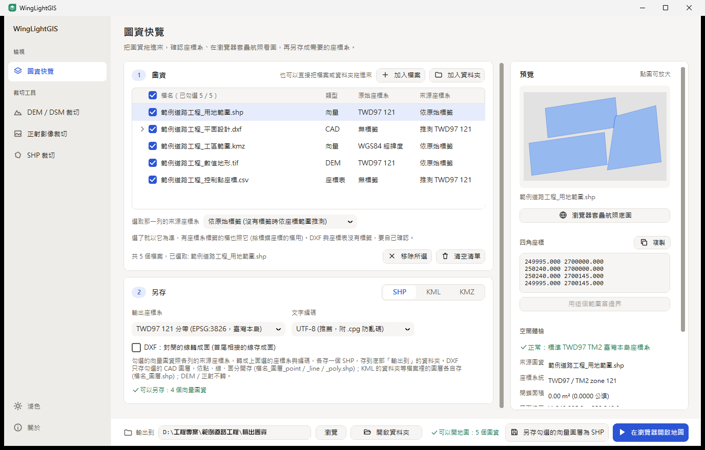
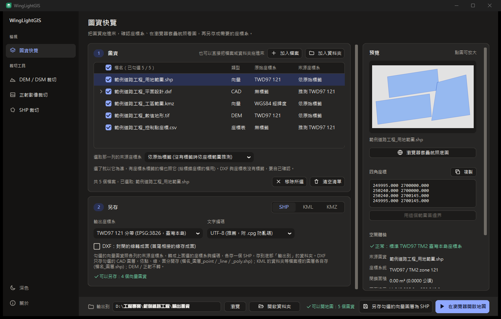

<div align="center">


# WingLightGIS

**給台灣工程人員的圖資快覽、座標轉換與範圍裁切工具**

[](LICENSE)
[](https://github.com/Human-chang/WingLightGIS)
[](.github/workflows/build.yml)
[](https://gdal.org/)

</div>

---

<p align="center">
  
  
</p>

## 為什麼做這個

工程現場每天收發地籍圖、CAD 平面設計、測量控制點、正射影像與數值地形（DEM／DSM），最常卡住的往往不是高深的空間分析，而是這幾件重複的瑣事：

1. **檔案打不開、不知道座標在哪裡**：客戶傳來的 `.shp`、`.dxf`、`.kmz`、`.gpx`、`.csv` 到底是什麼座標系？TWD67 還是 TWD97 121／119 分帶？想先套疊航照確認位置卻要等厚重的桌面 GIS 軟體開好久，甚至電腦還得遷就舊版 ArcMap 10.x（32-bit Python 2.7）環境而不敢亂裝套件。
2. **底圖太大、只要工區範圍內的圖資**：數百 MB 的全鄉鎮地籍或高精度正射／DEM 只需要某個工程界線周邊，還要同步轉成 AutoCAD 對位底圖、產生等高線 DXF，或整理裁切前後面積的 Excel 清冊。

**WingLightGIS** 把這些高頻工作濃縮成四個直覺分頁，自帶獨立沙盒 `runtime\`（Python 3.11 + GDAL 3.13 / PROJ 9.9），**絕不更動任何 Windows 系統環境變數**，解壓縮即可雙擊開啟，與本機既有的舊版 ArcMap / QGIS 和平共存。

---

## 功能表（主打五大核心能力）

| 功能 | 重點說明 | 網路需求 |
| :--- | :--- | :---: |
| **1. 圖資快覽** | 支援 **SHP、DXF、KML／KMZ、GPX、GPKG、GeoJSON、TIF／DEM、附世界檔（`.jgw`／`.pgw`）JPG／PNG、CSV 座標表** 拖入即看；可檢視單層／多層 CAD 圖層與 KML 資料夾；**在瀏覽器套疊國土測繪中心航照圖／電子地圖**，點選圖徵看屬性，並內建**簡易出圖**（圖名、指北針、圖例、比例尺，A4／A3 橫式列印）。 | 套疊底圖需連網<br>本機預覽與轉檔離線 |
| **2. 座標系轉換** | 依標籤與座標範圍自動判別或逐列手動指定來源座標系；支援 **TWD67（台灣七參數）與 TWD97 121／119 分帶互轉**；勾選多圖層批次**另存 SHP**（UTF-8 附 `.cpg` 或 CP950）或 **KML／KMZ**（DXF 支援指定 CAD 圖層與封閉線轉面）。 | 本機離線 |
| **3. DEM／DSM 裁切** | 邊界支援匯入圖檔或貼座標；**輸出解析度可自訂**（如 `0.1 m`、`0.2 m`、`0.5 m`、`1 m`、`2 m`，自動防止細於原網格的超採樣）；支援**多幅 DEM 自動拼接（VRT）**，並同步產生**等高線 DXF**（首曲線／計曲線分層並帶高程）與**百分比坡度圖**。 | 本機離線 |
| **4. 正射影像裁切** | 支援 **GeoTIFF** 與**附世界檔（`.jgw`／`.pgw`）JPG／PNG**；**解析度可自訂**（`5 cm`～`100 cm`）與金字塔（`.ovr`）；可同步輸出 **AutoCAD 對位底圖（JPG + JGW）**。 | 本機離線 |
| **5. SHP 裁切** | 邊界支援載入 **SHP、DXF、KML／KMZ**（含多資料夾挑選）或**直接貼座標**；支援**環域外推／內縮**（公尺）與**整筆保留（`_whole.shp`）**；裁切後自動重算前後面積（`ORIG_M2`、`AREA_M2`、`AREA_HA`、`RATIO_PCT`）、長度與形心，並輸出整理好的**屬性統計 Excel（`.xlsx`）**。 | 本機離線 |

- 支援**單一執行個體**：把 `WingLightGIS.exe` 設成 `.shp` 等檔案的預設開啟程式後，雙擊檔案即可直接帶入圖資快覽；若視窗已開啟，會自動交給同一份實例不另開重複視窗。

---

## 下載與使用

1. 前往 [Releases 頁面](https://github.com/Human-chang/WingLightGIS/releases) 下載最新綠色免安裝壓縮檔 **`WingLightGIS-v1.0.0.zip`**。
   - **壓縮檔大小**：約 `111.0 MB`
   - **解壓後大小**：約 `331.2 MB`
   - **實測啟動時間**：啟動畫面 `0.10 秒`、主視窗出現 `1.27～1.29 秒`（打包後執行檔暖機 1 次＋連續實測 3 次：`1.29／1.27／1.29 秒`；首次冷啟動／暖機約 `2.97 秒`）
2. 完整解壓縮到任意本機資料夾（例如 `D:\Tools\WingLightGIS`），直接點兩下 **`WingLightGIS.exe`** 即可使用。
   - 設定檔（`config\WingLightGIS.json`、`recipes.json`）、暫存檔（`workspace_temp\`）與預設輸出目錄（`outputs\`）皆在程式資料夾內；若放在無寫入權限的目錄（例如 `C:\Program Files\WingLightGIS`），會自動改存至 `%APPDATA%\WingLightGIS\`。
3. **Windows Defender SmartScreen 提醒**：
   > ⚠️ 第一次執行時，Windows 可能會出現「Windows 已保護您的電腦」：這是因為本程式沒有付費的數位簽章，並不是病毒。請按 **「其他資訊」→「仍要執行」**。
   >
   > 本專案原始碼完全公開，發佈頁上的壓縮檔由 GitHub Actions 從原始碼自動建置打包，打包流程與建置紀錄皆公開可查。

---

## 從原始碼執行

需要 Windows 10/11 64-bit 與 .NET Framework 4.x（系統已內建）：

```bat
git clone https://github.com/Human-chang/WingLightGIS.git
cd WingLightGIS
setup_portable_env.bat
```

建置完成 `./runtime` 與 `WingLightGIS.exe` 後即可執行測試與啟動程式：

```bat
runtime\python.exe -m unittest discover -s tests -p "test_*.py"
WingLightGIS.exe
```

如需自行產出乾淨的綠色免安裝發佈包：

```bat
打包綠色免安裝版.bat
```

> **關於 `.bat` 檔案編碼說明**：為確保繁體中文 Windows 命令列（`cmd.exe`）執行不亂碼，既有的 `setup_portable_env.bat` 與 `launcher\build_launcher.bat` 採用 **CP950（Big5）** 編碼。於 GitHub 網頁版直接檢視這兩支檔案時顯示亂碼屬於正常現象，下載至 Windows 執行完全正常。

---

## English

**WingLightGIS** is a portable Windows GIS utility built for Taiwanese civil/survey engineers who need fast vector/raster inspection, coordinate transformation (**TWD67 seven-parameter ↔ TWD97 TM2 zone 121 / 119 / WGS84**), browser overlay on Taiwan NLSC WMTS aerial maps with A4/A3 print layout, and boundary clipping workflows (DEM/DSM with contour DXF & slope map, aerial orthophotos with AutoCAD world-file JPG export, and Shapefiles with recalculated area Excel reports).

- Powered by an isolated **Python 3.11 + GDAL 3.13 / PROJ 9.9** portable `runtime\` sandbox — zero system PATH or registry edits, completely safe alongside legacy **ArcMap 10.x (Python 2.7)**.
- All geometry/raster/export operations run locally offline; internet access is only required when loading NLSC WMTS aerial basemaps in the browser preview.

---

## License

- **WingLightGIS** source code (`main.py`, `core/`, `ui/`, `launcher/`) is licensed under the **[MIT License](LICENSE)**.
- The portable release ships a prebuilt conda-forge `runtime\` sandbox containing third-party open-source software (Python, GDAL, PROJ, GEOS, FreeXL, SpatiaLite, libarchive, WhiteboxTools, CustomTkinter, TkinterDnD2, Folium, Pillow, OpenPyXL, etc.), including copyleft GPL/LGPL components (`librttopo`, `lzo`, `geos`, `libfreetype`, `libspatialite` / `libarchive` GPL builds). Full license inventory and source acquisition details are included in the release's `第三方授權\` folder.
